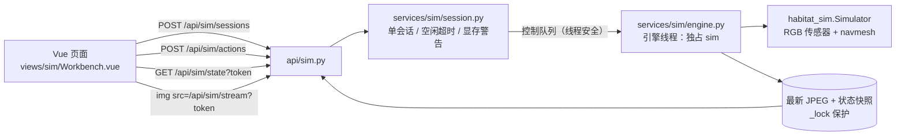

# 07 交互式仿真页面设计

> 关联：本文件是 [04-目录结构与代码规划.md](04-目录结构与代码规划.md) 的增量设计，接口风格沿用
> [03-接口设计.md](03-接口设计.md)，排期沿用 [06-开发计划.md](06-开发计划.md) 的里程碑体例。
> 迁移源：`/home/zjr/StreamVLN-kaggle-backup/scripts/dog_sim/interactive_vln.py`（单文件 CLI，约 1800 行）。

## 1. 背景与目标

平台已有「数据集 → 评测任务 → 轨迹回放 → 分析诊断」的离线闭环，但**没有任何在线仿真能力**：
回放只能看历史产物，无法回答"这条 episode 现在让狗走一遍会怎样"。

本页新增一个**交互式仿真工作台**：从平台已登记的数据集里挑一条 episode，在该场景里实时启动
一次 habitat_sim 仿真，用按钮或键盘手动驾驶机器狗；画面由后端合成，一个窗口里同时看到第一视角与俯视轨迹。

目标（按优先级）：

1. 一条 episode 从"选"到"能动"不超过 3 次点击，首次加载 5–20 秒有明确加载态。
2. 手动单步端到端 ≤ 100 ms（本地），按钮/键盘按下即有反馈。
3. 会话停止或空闲超时后，GPU 与 GL context 必须真正释放。
4. **不破坏既有约束**：无 habitat_sim 的环境（离线演示、Mock 流程）照常启动。

## 2. 首版范围

| 做 | 不做（留待后续版本） |
| --- | --- |
| 选数据集 / episode（预览指令、场景、成功半径） | 模型自动跑指令（StreamVLN 联动） |
| 启动 / 停止仿真会话，加载态与错误态 | oracle 最短路径虚线、一键自动走 |
| 第一视角 MJPEG 画面（只推新帧、断流重连） | 深度伪彩条、障碍预警 |
| 俯视轨迹：起点、终点圈、轨迹、狗位置与朝向 | SR / NE / SPL 在线指标面板 |
| 前进 0.25m / 左转 15° / 右转 15° / 停止 / 回起点 | 多人并发会话、会话持久化 |
| 键盘 ↑↓←→ / WASD / 空格，按住连发 | 轨迹落库、导出、进回放页 |
| 读数：步数、到目标距离、状态、显存警告 | 自定义场景/起终点表单 |

首版**只做手动驾驶**，"自动跑"的部分等在线指标与模型接入一起做（届时引擎的 4Hz 动作队列
与 `submit()` 接口直接可用，不需要改协议）。

## 3. 架构

### 3.1 进程与线程模型

仿真跑在**后端进程内的独立线程**（用户已确认的取舍：简单优先，接受"仿真崩了会带崩服务"）。
关键是**所有 `habitat_sim` 调用只发生在这个线程里**：



| 角色 | 允许碰什么 | 不允许 |
| --- | --- | --- |
| HTTP 线程（uvicorn） | 投递控制命令、读快照、拿最新 JPEG 字节 | 直接调 `sim.*` |
| 引擎线程（1 个） | `sim` 的全部操作（渲染、动作、换局、关闭） | 碰 FastAPI 对象 |
| 前端 | 轮询 `/state`、`` | — |

`habitat_sim` 采用**懒加载**：`import habitat_sim` 只出现在引擎线程的启动函数里。
缺依赖时接口返回 `error` 状态 + 文案，平台其余功能完全不受影响（守住「离线可演示」约束）。

### 3.2 会话状态机

```
idle ──POST /sessions──▶ loading ──▶ ready ──DELETE──▶ stopped
                            │           │
                            └──error◀───┘（场景缺失 / 无 habitat_sim / 建模失败）
```

- `loading`：正在 `build_sim`（5–20 秒），`state` 可读，`actions` 返回 409 且文案明确。
- `ready`：可操控、可推流。
- `error`：带 `message`，`state` 仍可读，前端给「重试」。
- 单会话互斥：`POST /sessions` 会先停掉旧会话再建新的，不会出现两个 sim 争卡。

### 3.3 渲染与推流

一帧 = 第一视角(640×480) 与 俯视图(640×480) 左右拼接的 1280×480 JPEG：

| 步骤 | 耗时 | 优化 |
| --- | --- | --- |
| `get_sensor_observations()` | 1–6 ms | — |
| 俯视底图 | ~0.5 ms | navmesh 三角面**只画一次**后缓存静态层，每帧只 copy |
| 轨迹 + 狗 | ~3 ms | 只画动态部分 |
| HUD 文字 | ~0.4 ms | 无中文字体时用 `cv2.putText`；有 CJK 字体才走 PIL + 按内容缓存 |
| JPEG 编码 | ~2 ms | 每帧只编一次，多观众共享同一份字节 |

- 限帧：无人观看 15 fps（`render_hz`），有 `/stream` 连接时 20 fps（`stream_hz`）。
- 手动动作走控制队列**即时执行并强制出一帧**；4 Hz 节拍只保留给将来的自动策略。
- `/stream` 只在 `frame_seq` 变化时写一帧，空闲时 `await asyncio.sleep(0.01)`，不忙等。

## 4. 接口契约

前缀 `/api/sim`，统一返回 `{"code","message","data"}`；`stream` 返回裸 MJPEG 字节。

| 方法 | 路径 | 鉴权 | 说明 |
| --- | --- | --- | --- |
| POST | `/api/sim/sessions` | `require_roles("admin","operator")` | 建会话；body `{episode_id, gpu_id?}` |
| GET | `/api/sim/state` | `get_user_allow_query_token` | 读快照（前端轮询 0.8 s） |
| POST | `/api/sim/actions` | `require_roles("admin","operator")` | body `{action}` |
| GET | `/api/sim/stream` | `get_user_allow_query_token` | MJPEG，`multipart/x-mixed-replace; boundary=frame`；超出 `max_clients` 先回 429 |
| DELETE | `/api/sim/sessions/{session_id}` | `require_roles("admin","operator")` | 停止并释放；`current` = 停掉现有会话 |

`POST /sessions` → `data`：

```json
{"session_id": "6f1c9a2d7e04", "status": "loading",
 "episode": {"episode_id": 1, "dataset_name": "R2R-CE val_unseen", "episode_code": "1",
             "scene": "zsNo4HB9uLZ", "instruction": "Exit the bedroom ...",
             "radius": 3.0, "start": [15.07, 0.17, -4.48], "goal": [13.05, 0.17, 1.87]},
 "warning": "GPU0 剩余显存仅 5.2 GB（阈值 976.6 GB），仿真可能与其他任务争抢显存"}
```

`GET /state` → `data`（无会话时 `status="idle"`，其余字段为默认值）：

```json
{"status": "ready", "message": "", "warning": null,
 "session_id": "6f1c9a2d7e04",
 "episode": {"episode_id": 1, "scene": "zsNo4HB9uLZ", "radius": 3.0, "start": [...], "goal": [...]},
 "steps": 10, "distance": 6.5745, "done": false,
 "pose": {"x": 14.3296, "z": -4.5741, "yaw_deg": 90.0},
 "trail": [[15.069, -4.485], [14.329, -4.574]],
 "frame_seq": 231, "fps": 15.0, "radius": 3.0, "uptime_s": 42.3}
```

`POST /actions` 的 `action` 取值：`forward | left | right | stop | reset`（大小写不敏感，非法值 400）；
返回 `{steps, distance, done, status, message, frame_seq}`，便于前端立刻更新读数而不等轮询
（服务端会等服务出新帧再返回，端到端约 20 ms）。

错误码沿用既有约定：`1001` 参数非法/状态冲突（`loading` 时下动作、缺会话）、
`1003` 角色不足、`1004` episode 或会话不存在、`2001` 仿真组件不可用（缺 habitat_sim）。

## 5. 数据来源与位姿解析（易错点）

平台里的 episode 位姿与旧脚本的 R2R 原始字段**形状不同**，必须按下表解析：

| 字段 | 实际内容 | 说明 |
| --- | --- | --- |
| `episode.start_pose_json` | `[x, y, z, yaw]` | `yaw` 是**弧度**（`utils/geometry.pose_from` 由四元数提取） |
| `episode.goal_pose_json` | `[x, y, z, 0.0]` | 终点无朝向，`yaw` 恒为 0 |
| `episode.scene_id` | `zsNo4HB9uLZ` | **短名**，已剥掉 `mp3d/`、`.glb` |
| `episode.meta_json` | `{"raw_scene_id": "mp3d/zsNo4HB9uLZ/zsNo4HB9uLZ.glb", "goal_radius": 3.0, ...}` | 优先用 `raw_scene_id` 拼路径 |
| `dataset.meta_json["scene_root"]` | `/home/zjr/StreamVLN-kaggle-backup/data/scene_datasets` | 备份库导入时写入；为空则回落到 `import.backup_root/data/scene_datasets` |

场景文件解析顺序（`episode.py::resolve_scene`）：

1. `scene_root / raw_scene_id` 存在 → 直接用；
2. 否则 `scene_root/**/<scene_id>.glb`（优先非 `.basis.glb`）；
3. 都没有 → `AppError(NOT_FOUND, "场景文件缺失：<scene_id>")`。

起始朝向：`yaw`（弧度）转四元数需按 **scalar-last `[x,y,z,w]`、绕 Y 轴**：
`rot = [0, sin(yaw/2), 0, cos(yaw/2)]`。

## 6. 配置项

`config/default.yaml` 新增 `sim:` 段（与 `core/config.py` 的 `DEFAULT_CONFIG` 同步，全部有内置默认值，缺省也能启动）：

```yaml
sim:
  # Habitat 场景根目录（其下形如 mp3d/<scene_id>/<scene_id>.glb）；留空时按
  # episode.meta_json.raw_scene_id、dataset.meta_json.scene_root、import.backup_root 依次回落
  scene_root: /home/zjr/StreamVLN-kaggle-backup/data/scene_datasets
  gpu_ids: [0]                      # 第一张为默认；前端可在建会话时用 gpu_id 覆盖
  tick_hz: 4.0                      # 自动策略节拍（首版不启用，手动单步是即时生效的）
  render_hz: 15.0                   # 无人观看时的渲染上限
  stream_hz: 20.0                   # 有浏览器在看画面时的渲染上限
  jpeg_quality: 82
  max_clients: 4                    # 同时观看 MJPEG 的连接数上限（超出返回 429）
  idle_timeout_s: 900               # 无状态请求超过该秒数自动停会话，0 = 不超时
  free_mem_warn_mb: 4096            # 剩余显存低于该值时进 warning（不阻塞启动）
```

`core/config.py` 新增 `SimConfig` dataclass 并挂到 `Settings.sim`，与既有 `SchedulerConfig` 同级；
`_load_sim_config()` 负责兜底与范围收敛（`jpeg_quality` 限 40–98、`max_clients` ≥ 1）。
首版没有 `enabled` 开关与 `load_timeout_s`：会话的可用性由 `habitat_sim` 是否可 import 决定，
建场景超时靠前端 loading 态 + 用户手动停止（见 §12）。

## 7. 目录结构与行数预算

```
backend/app/
├── api/sim.py                  [NEW]  87 行  5 个接口 + MJPEG 生成器 + 动作白名单
└── services/sim/
    ├── __init__.py             [NEW]  10 行  只导出 SimSession / SimSpec
    ├── constants.py            [NEW]  68 行  动作码、步长、上限、默认半径、渲染参数
    ├── episode.py              [NEW] 233 行  DB episode → SimSpec（位姿/场景/半径解析）
    ├── scene.py                [NEW]  75 行  build_sim()、yaw_of()、传感器与动作空间（懒加载 habitat_sim）
    ├── topdown.py              [NEW] 154 行  TopDownMap + draw_* 系列
    ├── engine.py               [NEW] 435 行  SimEngine：控制队列/即时动作/渲染/关闭
    └── session.py              [NEW] 285 行  单例会话、状态机、空闲超时、显存警告

frontend/src/
├── router/index.js             [MODIFY] +6 行 /sim 懒加载路由
├── layouts/DefaultLayout.vue   [MODIFY] +4 行 菜单项
├── api/index.js                [MODIFY] +6 行 simStart/simStop/simState/simAct
└── views/sim/Workbench.vue     [NEW] 787 行 选局条 + 单个画面窗口 + 操控条 + 读数条
```

行数与项目既有文件同量级（`services/backup_import_service.py` 1108 行、`views/analysis/Index.vue` 1209 行），
没有为凑行数做无意义拆分。

## 8. 旧脚本 → 新模块映射

| 旧（interactive_vln.py） | 新位置 | 迁移方式 |
| --- | --- | --- |
| 常量块（动作码、步长、15°、500 步、3.0m、渲染参数） | `sim/constants.py` | 原样搬，去掉 CLI 专用项 |
| `SimConfig` / `load_episode` / `from_episode` | `sim/episode.py` 的 `SimSpec` + `spec_from_episode()` | 改成从 DB 行构造；场景路径按多候选根目录解析（见 §5） |
| `build_sim()` / `yaw_of()` / 传感器与 action_space | `sim/scene.py` | 原样搬，加 `gpu_id` 参数与 navmesh 重建日志 |
| `TopDownMap` + `draw_goal/draw_start/draw_trail/draw_dog_marker` | `sim/topdown.py` | 原样搬；新增 `draw_scale_bar()`（web 端无 HUD 说明行，靠比例尺传达尺度）；`draw_route_hint` / `draw_oracle_path` 首版不迁 |
| `DogSimEngine`（动作队列 / `_apply` / `render` / `run` / `_drain_control`） | `sim/engine.py` 的 `SimEngine` | 去掉 HTTP/MJPEG/`web_port`，改为 `snapshot()` + `latest_jpeg()` |
| `_serve_mjpeg()`（标准库 http.server） | `api/sim.py` | 换成 `StreamingResponse` + async 生成器（只推新帧） |
| `EpisodeBook`（12 个指标字段） | `engine.py` 内部小结构 | 首版只留 `steps / distance / done / trail` |
| `hud_lines()`（8 行 HUD） | `engine.py` 的 `_hud_lines()` | 只留 3 行：局信息 / 步数与距离 / 操作提示 |
| `--selftest` 自检 | 旧脚本保留 | 薄封装后仍可跑，作为迁移回归基线 |

**回归基线（迁移必须逐项一致）**：`val_unseen #0`（`zsNo4HB9uLZ`）
`--selftest 10` = 前进 4 + 左转 2 + 前进 4 + 停止 → **10 步、距目标 6.57 m、路程 1.07 m**。

## 9. 分步实施计划

每步都可独立验收、独立回滚。S1–S2 只碰新文件，S3 起才开始改既有文件。

### S1　仿真引擎内核（1.5 天）

- 改动：`sim/constants.py`、`sim/scene.py`、`sim/topdown.py`、`sim/engine.py`、`sim/__init__.py`。
- 要点：
  - `SimEngine(spec, gpu_id, render_hz, stream_hz)`；内部线程跑 `run()`；
  - 控制队列 `queue.Queue`，`act(action)` 投递，线程内 `_apply()` 立即执行并置 `_force_render`；
  - `snapshot()` 返回 `{status,steps,distance,done,pose,trail,frame_seq}`（`_lock` 保护）；
  - `latest_jpeg()` 返回 `(bytes, seq)`；
  - 任何异常收敛为 `status="error"` + `message`，线程不崩。
- 验收：用临时脚本直接驱动 `SimEngine`（等价于计划里的 `-m` 自检入口，未单独做 `__main__`）：
  `spec_from_episode(db, 1)` → 起线程 → 等 `ready` → 走 10 步 → 输出 10 步 / 6.57 m / 首帧 > 0 B；
  连跑两次不报 GL 错误。

### S2　数据库 → 仿真配置（1 天）

- 改动：`sim/episode.py`；`core/config.py` 增加 `SimConfig`；`config/default.yaml` 增加 `sim:`。
- 要点：按 §5 解析位姿与场景；`goal_radius` 缺失回落 3.0；找不到场景抛 `NOT_FOUND` 并在文案里带 scene_id。
- 验收：对 DB 里 R2R val_unseen 第 0 条调 `spec_from_db()`，打印的 start/goal/radius/scene_path
  与硬编码基线一致（距离误差 < 1e-3）；改一个不存在的 scene_id 能拿到明确异常文案。

### S3　会话服务与 HTTP 接口（1.5 天）

- 改动：`sim/session.py`、`api/sim.py`；`main.py` 注册路由 + lifespan 关闭；README 补接口。
- 要点：
  - `SimSession` 单例：`start(episode_id, gpu_id)` 先停旧会话 → `loading` → 线程建 sim → `ready`；
  - 空闲超时：每 30 s 检查一次 `last_touch`，超过 `idle_timeout_s` 自动 `stop()`；
  - 显存警告：启动前读 `services/system._gpu_info()`，空闲 < `free_mem_warn_mb` 时写 `warning`；
  - MJPEG 生成器：`async for chunk in session.iter_mjpeg(request)`，`await asyncio.sleep(0.01)` 轮询，
    客户端断开（`await request.is_disconnected()`）即退出并减 `stream_clients`；
  - 关闭顺序：先 `stop_flag` 停线程 → `join(5)` → `sim.close()`，挂到 lifespan shutdown。
- 验收：`curl` 全流程 —— 建会话 → 轮询 `state` 变 `ready` → `actions` 三步 steps 递增 →
  `/stream` 3 秒收到 ≥40 个 frame 边界 → `DELETE` 后 `nvidia-smi` 显存回落、`state` 为 `stopped`；
  `viewer` 账号 POST 返回 1003（角色不足）；`loading` 期间 POST actions 返回 1001（状态冲突，HTTP 409）；
  episode 不存在返回 1004。

### S4　前端工作台（2 天）

- 改动：`views/sim/Workbench.vue`、`router/index.js`、`layouts/DefaultLayout.vue`、`api/index.js`。
- 要点：
  - 版式沿用既有卡片与 Element Plus 组件，**不引入新配色/组件库**；只有一个画面窗口，深底；
  - 选局：数据集下拉 → episode 下拉（`api.episodes`），预览场景/指令/成功半径；
  - 画面：``，URL 带 `?token=`；`frame_seq` 3 秒不动则重挂一次 `src`；
  - 操控：按钮 + 键盘（↑/W、←/A、→/D、空格），按住 90 ms 连发；输入框内不拦截按键；
  - 读数：0.8 s 轮询 `/state`，动作后再立即刷一次；`warning` 用 `el-alert` 细条；
  - 状态：`loading` 骨架屏 + 文案，`error` 居中原因 + 重试，按钮按角色禁用（viewer 只读）。
- 验收：`npm run build` 后从侧边栏进入「交互式仿真」，选 R2R val_unseen #0 → 启动 → 画面 3 秒内出图、
  键盘 ↑ 连续走、俯视图轨迹随动、停止后按钮回到「启动」；刷新页面能恢复正常态（不留幽灵会话）。

### S5　旧 CLI 薄封装与端到端回归（0.5 天）

- 改动：`/home/zjr/StreamVLN-kaggle-backup/scripts/dog_sim/interactive_vln.py` 改为几十行壳
  （import 平台 `SimEngine`，保留 `--selftest / --episode / --model` 参数语义，`--web-port` 提示改用平台页面）。
- 验收：
  1. 旧 CLI `--selftest 10` = 10 步 / 6.57 m（与本文件 §8 基线一致）；
  2. 平台页面同一局同样的 10 步后读数一致；
  3. 无 habitat_sim 的环境（`CUDA_VISIBLE_DEVICES=""` 且 mock 掉 import）启动平台，除仿真页报
     `2002` 外其余页面正常；
  4. 服务 `Ctrl-C` 退出后无残留进程、`nvidia-smi` 显存回落；
  5. 回归结果填入 §11。

## 10. 风险与对策

| 风险 | 影响 | 对策 |
| --- | --- | --- |
| 仿真线程异常拖垮服务 | 全站不可用 | 引擎线程内 `try/except` 全包；`import habitat_sim` 懒加载；GL 相关调用串行 |
| 忘记释放 GL context | 下次启动变慢/报错 | `stop()` 严格按"停线程 → join → sim.close()"；lifespan shutdown 兜底 |
| 两个会话抢同一张卡 | 显存 OOM，评测被打断 | 单会话互斥；启动前读显存给 `warning`（用户已选「只给警告」） |
| 场景文件不在本机 | 页面报错不解释 | 解析失败抛 `NOT_FOUND` + 文案带 scene_id 与期望路径 |
| 起始位姿不在 navmesh 上 | 狗卡在墙里 | 复用旧脚本 `snap_point` 兜底，并在 `state.warning` 提示已吸附 |
| `--reload` 开发模式 | reload 重建进程强杀引擎线程 | 文档与 README 明确：调试仿真不要用 `--reload` |
| 前端轮询过密 | 接口压力 | 0.8 s 轮询 + 动作后单次额外刷新；`/stream` 只推新帧 |

## 11. 验收记录（2026-11-06 执行）

环境：`/home/zjr/miniconda3/envs/streamvln-kb/bin/python`（habitat_sim 0.2.4 / numpy 1.26.1 / cv2 已装），
平台 `python run.py --no-browser`（8080），仿真跑在 GPU0。

| 步骤 | 判据 | 结果 |
| --- | --- | --- |
| S1 | 引擎自检 10 步 / 6.57 m / 帧数 > 0 | **通过**。`spec_from_episode(1)` → `mp3d/zsNo4HB9uLZ/zsNo4HB9uLZ.glb`；建场景 5.0 s；首帧 53 147 B；10 步后 `distance=6.5745 m`、`trail=9` 点、`done=True`；`reset` 后回到 6.6726 m（= 原始欧氏距离） |
| S2 | DB → SimSpec 与硬编码基线一致 | **通过**。起点 `[15.0686, 0.1716, -4.4848]`、终点 `[13.0464, 0.1716, 1.8740]` 与 `val_unseen.json.gz` 第 0 条逐位一致；`yaw=1.0472`（库里 4 位小数）重建四元数与原始 `[0, 0.5, 0, 0.866]` 差 1e-6，10 步读数无影响；`episode_id=999999` → 404「episode 不存在」；场景根按 `sim.scene_root` 命中（`dataset.meta_json.scene_root` 指向的旧路径已失效，靠配置兜底） |
| S3 | 五接口全流程 + 显存回落 + 权限/状态码 | **通过**。`state=idle` → `POST sessions` 返回 `loading` → 5 s 后 `ready`；10 次 `actions` 返回 `steps=10 / distance=6.5745`；`/stream` 2 s 收到 41 个 `--frame` 分块、2 080 KB、稳定 19.6 fps（无人观看时 15.0 fps）；`DELETE` 后显存 `41 086 → 40 779 MiB`（回到会话开始前的基线，净 0）；`viewer` POST → 403「需要角色：admin/operator」；`operator` POST → 200；坏 token → 401 code 1002；`action=jump` → 400 白名单提示 |
| S4 | 构建后页面可操作、无幽灵会话 | **部分通过**。`vite build` 成功（sim 页 chunk `Workbench-*.js` 16.1 kB / CSS 8.1 kB），`/sim` 返回 index.html、`/assets/index-*.js` 与全部懒加载 chunk 均 200；`/sim/state` 空会话返回 `idle`。浏览器内的键鼠连发与断流重连需人工点验（本机无可用浏览器自动化） |
| S5 | 旧 CLI 与平台页面读数一致、退出无残留 | **通过**。薄封装 `--selftest 10` → `10 步 / 6.57 m / trail=9`，与旧 CLI 逐项一致；同一局经 `/api/sim/actions` 走同样 10 步 → `6.5745 m`；服务 `SIGTERM` 后无残留 python 进程，显存回到基线 |

可复现命令：

```bash
# 引擎/接口回归
/home/zjr/miniconda3/envs/streamvln-kb/bin/python /tmp/sim_selftest.py 1 2   # 引擎层
/home/zjr/miniconda3/envs/streamvln-kb/bin/python /tmp/api_sim_test.py        # 五接口（需平台已启动）
# 旧 CLI 基线
cd /home/zjr/StreamVLN-kaggle-backup && \
  /home/zjr/miniconda3/envs/streamvln-kb/bin/python scripts/dog_sim/interactive_vln.py --selftest 10
# 前端构建（本机 shell 注入了 safe-delete shim，必须关掉 NODE_OPTIONS 且不清理 outDir）
cd /home/zjr/nav-eval-studio/frontend && \
  env -u NODE_OPTIONS /home/zjr/StreamingVLA/tools/node-v20.18.0-linux-x64/bin/node \
  ./node_modules/vite/bin/vite.js build --emptyOutDir false
```

### 11.1 与计划的差异（实现备注）

1. `state` 里用 `fps`（最近 1 秒的实渲染帧数）替代了计划草稿中的 `stream_clients` / `idle_seconds`：
   前端要显示帧率，而连接数在服务端已用于限流，`uptime_s` 足够表达会话时长。
2. `distance` 保留 4 位小数（前端按 2 位展示）。若在服务端先 `round(3)`，`6.5745 → 6.575`
   会在前端显示成 `6.58`，与旧基线 `6.57` 对不上——这是必须逐位对齐的地方。
3. 建会话时若上一局仍在 `loading`，直接返回 409 而不是排队：两个 `Simulator` 同时抢同一个
   GL context 会崩进程，宁可让用户等 5–20 秒。
4. `--selftest` 不再受 4 Hz 节拍限制，10 步在 0.1 s 内跑完（手动/自检都是即时 `_apply`）；
   4 Hz 只留给后续的模型/自动策略。
5. 旧的 `--save-dir`、`--web-port`、`--model` 参数保留名称但只打印提示：帧落盘与网页交互已由
   平台接管，模型联动不在首版范围。
6. **画面沿用旧脚本的 `hstack` 合成图（1120×480）**：左 640×480 第一视角（左下角烧 HUD 读数），
   右 480×480 俯视图（navmesh 底图、起点、目标圈、轨迹、狗、比例尺）。页面因此**只有一个画面窗口**，
   操控条与读数条都放在画面下方——不再另开俯视面板（俯视图只画一份，避免重复与两套渲染代码）。
7. 因此下线了 `GET /api/sim/map` 与前端自绘的 `SimTopdown.vue`（原计划由前端 canvas 复刻俯视图）；
   俯视图的投影/裁剪/性能优化复用引擎里已验证的实现。
8. `/stream` 的观看名额在**返回响应之前**占用，超限回 429 JSON；生成器内每轮心跳一次，
   超过 60 s 无心跳的连接按僵尸回收（浏览器直接关标签页时 `finally` 不保证执行，曾因此把名额占满）。
9. `GET /api/datasets` 返回的是**数组**而不是 `{items,total}`（episodes 才是分页对象），
   前端两种形状都兼容；默认自动选中「第一个有 episode 的数据集」，否则会停在 0 局的训练集上。
10. 前端构建受本机 VSCode 扩展注入的 `NODE_OPTIONS`（safe-delete shim）影响，
   `npm run build` 会在清空 `dist` 时报 `spawnSync ... ENOENT`；绕过方式见上面的命令。
   **这不是代码问题**，CI/干净环境用 `npm run build` 即可。

## 12. 后续版本（不在本次范围）

1. **在线指标与 oracle**：把旧脚本的 `EpisodeBook`（NE/SPL/STOP 门控）与 `compute_oracle()` 搬进
   `engine.py`，页面加指标卡与「oracle 自动走一遍」。
2. **深度消费**：`head_depth` 伪彩缩略图 + 前方距离预警（只展示，不进模型）。
3. **模型联动**：复用 `adapters/` 的子进程模式接 StreamVLN，或把 `vln_policy` 的推理线程搬进来，
   用引擎已有的 4 Hz 队列消费动作。→ 已单独出规划并**已交付**（P1–P5 全通过，仿真与模型同跑 GPU2）：
   [08-交互式仿真接入模型预测.md](08-交互式仿真接入模型预测.md)（实测数据见其 §13）。
4. **会话资产化**：轨迹与关键帧写入 `artifact`，支持在「轨迹回放」页复现本次仿真。
