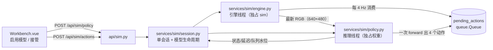

# 08 交互式仿真接入模型预测

> 状态：**已实施（P1–P5 全部验收通过，2026-11-06，GPU2 实跑）**。实施记录与实测数据见 §13。
> 前置：[07-交互式仿真页面设计.md](07-交互式仿真页面设计.md)（手动驾驶台已交付）、
> [03-接口设计.md](03-接口设计.md)（接口风格）。
> 复用源：`/home/zjr/StreamVLN-kaggle-backup/scripts/dog_sim/vln_policy.py`（332 行，旧脚本的模型接线）。
> 对应 07 文档 §12 的第 1、3 条（在线指标 / 模型联动），本次只做**模型联动**。

## 1. 背景与目标

07 交付的是手动驾驶台：人按键，狗动。缺的是"**让模型自己开**"——
把当前第一视角画面和指令喂给 StreamVLN，由模型输出动作序列，仿真按节奏执行，
人在旁边看它走得好不好，随时可以接管。

目标（按优先级）：

1. 选一局 → 启动仿真 → 选模型 → 开"模型驾驶"，**不需要人按键**就能连续走。
2. 模型慢（一次 forward 1.8–7.7 s，出 4 个动作）是常态，**不能卡住画面**：渲染与推流照常 15/20 fps，
   页面明确显示"模型推理中（已 2.3 s）"。
3. 随时**手动接管**：按键盘立刻抢过控制权，模型动作队列作废，不产生"人机打架"。
4. 模型加载/推理失败**不影响**手动驾驶，也不拖垮平台其余功能。

## 2. 首版范围

| 做 | 不做（留待后续） |
| --- | --- |
| 从模型档案里选一个 `family=streamvln` 的模型，懒加载到 GPU | 多模型同时加载 / 模型热切换（切换=先停再起） |
| 一次推理出 `num_future_steps=4` 个动作，按 4 Hz 依次执行 | 动作 chunk 内插、多步搜索、beam |
| 页面显示：模型状态、当前延迟、队列水位、动作来源 | SR / NE / SPL 在线指标（属 07 §12 第 1 条） |
| 手动接管（键盘/按钮）与恢复模型驾驶 | 自定义指令输入（首版用 episode 自带 instruction） |
| 推理异常/超时 → 自动降级为手动 + 中文原因 | 深度图/位姿真值参与推理（`prune_mode=off`，几何张量是占位） |
| 单会话单模型、与评测任务抢卡时给警告 | 多人并发、模型侧批处理 |

## 3. 现状盘点（已核对，非推测）

### 3.1 引擎侧：只有手动动作，没有"自动策略"

- `services/sim/engine.py:127-139` 的 `request_action(action: str)` 只接受
  `forward/left/right/stop/reset`，塞进 `_cmd` 队列由引擎线程 `_drain()` 执行。
- `SimEngine.__init__` 收了 `tick_hz` 并算出 `self.tick = 1/4 s`（`:54`），但**从未使用**——
  07 文档里说的"4 Hz 队列已留好"其实只是个参数位。
- 结论：**需要新建**"动作源"概念（manual / model）与 4 Hz 消费节拍。

### 3.2 平台侧：没有单步推理能力

- `adapters/` 只有两种：`MockAdapter`（确定性假数据）与 `StreamVLNAdapter`
  （`torchrun` 起子进程整段跑 `eval_split`，逐行 tail `result.json` 拿进度）。
- 全仓 `from_pretrained` / `StreamVLNForCausalLM` 零命中——平台**从未**在进程内加载过权重。
- 结论：单步推理要从零搭，不能靠现有 adapter。

### 3.3 旧脚本的 `vln_policy.py` 是关键资产（但带副作用）

`VLNPolicy`（`vln_policy.py:108`）已经解决了最脏的部分：

```python
VLNPolicy(dry_run=False, model_path=DEFAULT_CKPT, num_frames=32, num_history=8,
          num_future_steps=4, habitat_config="config/vln_r2r.yaml",
          seed=42, prune_mode="off")
step(rgb_uint8, instruction=None, instruction_override=True) -> list[int]   # 0停/1前/2左/3右
```

已知约束（来自文件头与实测记录）：

| 项 | 数值 | 影响 |
| --- | --- | --- |
| 显存 | `load_in_8bit=True`，bf16，约 **12–14 GB** | 与仿真同卡易 OOM（仿真约 4.3 GB） |
| 加载耗时 | 权重 ~7 GB 冷读，**20–60 s** | 必须异步加载 + 加载态 |
| 单次 forward | **1.8–7.7 s**，出 4 个动作 | 有效决策频率 0.5–2 Hz，必须解耦 |
| 历史窗口 | `num_history=8`，`num_frames` 次 forward 触发一次历史汇总 + `reset_for_env(0)` 清 KV | 参数不能乱改，否则 `<memory>` 特征缺失 |
| 几何输入 | depth 全零 5D、pose=eye(4)，**仅 `prune_mode="off"` 安全** | 不能开剪枝 |
| 环境依赖 | torch 2.1.2+cu121 / transformers 4.45.1 / bitsandbytes 0.41.0 / accelerate 0.28.0 / habitat_sim 0.2.4 | **`streamvln-kb` 已全部具备**（已核对版本） |

**必须处理的副作用**（这是本方案最大的坑）：

1. `__init__` 里 `os.chdir(REPO_ROOT)`（`:116`）——**`chdir` 是进程级**的，
   会改掉 FastAPI 主进程的工作目录，影响 `storage/`、`config/` 的相对路径解析。
2. `sys.path` 注入 `STREAMVLN_DIR` 与仓库根（`:57-59`），并往 `sys.modules` 塞 `streamvln_eval`。
3. 依赖 `config/vln_r2r.yaml`（相对仓库根）。

结论：**不能直接 `import vln_policy`**，必须把 `VLNPolicy` 的核心搬进
`services/sim/policy.py`，改掉 cwd/sys.path 依赖，用显式路径 + `importlib` 加载。

### 3.4 资源现状（2026-11-06 14:5x 实测）

| GPU | 总显存 | 已用 | 空闲 | 可跑模型？ |
| --- | --- | --- | --- | --- |
| 0 | 46 GB | 40.8 GB | 5.3 GB | 否（仿真默认在这） |
| 2 | 46 GB | 31.2 GB | **14.5 GB** | 勉强（8bit 12–14 GB） |
| 1/3/4/5/6/7 | 46 GB | 40.8~43.7 GB | 2.3~5.3 GB | 否 |

结论：**必须分卡**（仿真 GPU0 + 模型另一张），并且启动前做**硬校验**（不是 07 里的软警告）。

### 3.5 已失效的配置

`config/models.yaml` 里 StreamVLN 档案的 `code_path` / `weights_path` 指向
`/mnt/workspace/StreamVLN-kaggle-backup/...`，本机**不存在**；真实路径是
`/home/zjr/StreamVLN-kaggle-backup`（权重目录已确认存在）。
→ P1 顺带把 `models.yaml` 与 `model_profile` 表里的路径修对（或用自动配置的探测逻辑）。

## 4. 关键决策

| # | 决策 | 方案 | 理由 |
| --- | --- | --- | --- |
| D1 | 模型跑在哪 | **同进程 + 独立推理线程**（备选：独立子进程 + 本地 socket） | `streamvln-kb` 环境已齐备，省掉 IPC/端口/序列化；Python 层异常可用 try/except 兜住。子进程方案只在"审核认为 CUDA OOM 会拖垮服务"时启用（见 §11 备选 B） |
| D2 | 与仿真同卡还是分卡 | **分卡**：`sim.gpu_ids` 跑仿真，`policy.gpu_id` 跑模型；`null` = 自动挑空闲最多的一张 | 模型 12–14 GB + 仿真 4.3 GB 同卡必炸（本机 8 张卡都已占 40 GB+） |
| D3 | 推理与执行节奏 | **异步解耦**：模型线程产出动作 → 进 `pending_actions` 队列；引擎线程按 **4 Hz** 逐个消费；队列空就停住等 | 一次 forward 1.8–7.7 s，同步等会把画面卡死；4 Hz 与评测 `slow_update_interval` 节奏一致 |
| D4 | 喂什么给模型 | 只喂 `head_rgb`（640×480，与评测同源）+ episode 指令；`num_frames=8`、`num_history=8`、`prune_mode=off` | 深度/位姿是占位零值，开了剪枝会算错；`num_frames=8` 对齐评测节奏（8×4=32 环境步一轮） |
| D5 | 故障隔离 | 推理线程任何异常 → `policy.status="error"` + 中文原因 + **自动回手动**；单次 forward 超时 30 s 中止 | 模型侧不能影响画面与手动驾驶 |
| D6 | 接管语义 | 手动动作**优先级高于**模型；一旦手动介入 → 暂停模型推理 + 清空动作队列 + `reset` KV | 画面已经变了，旧 KV 继续算会给出不符合当前视角的动作 |

## 5. 架构



线程与数据流：

1. **引擎线程**（已有）：渲染 15/20 fps、执行动作。新增职责：每 `1/tick_hz` 从 `pending_actions`
   取一个动作执行；队列空则跳过（不额外渲染）。
2. **推理线程**（新增）：`while running` → 取引擎最新 RGB + 指令 → `policy.step()` →
   把返回的 0–3 编码动作转成字符串塞进 `pending_actions` → 记录延迟。
   推理线程**不碰 `sim`**，只读引擎发布的 JPEG 帧（已有 `latest_frame()`）。
3. **HTTP 线程**：只做三件事——开关模型、丢手动动作、读状态。

状态机（policy）：

```
off ──启动──> loading（加载权重 20–60 s）──> ready
ready ──推理中──> running（4 Hz 消费）──手动接管──> paused
running/paused ──停止/异常──> off / error
```

## 6. 接口契约

沿用 `{code,message,data}` 与既有鉴权（写操作 `admin/operator`；`viewer` 只读）。

| 方法 | 路径 | 说明 |
| --- | --- | --- |
| POST | `/api/sim/policy` | 启用模型：`{model_id, gpu_id?}`；立即返回 `{status:"loading"}`，加载在后台线程 |
| DELETE | `/api/sim/policy` | 停用并释放显存：`{status:"off"}` |
| POST | `/api/sim/policy/pause` | 暂停/恢复：`{paused: true|false}` |

`GET /api/sim/state` 增加 `policy` 字段（不影响现有字段）：

```json
{
  "status": "ready",
  "policy": {
    "status": "running",
    "model": "StreamVLN-R2R-RxR-v1.3",
    "gpu_id": 2,
    "pending": 2,
    "last_latency_ms": 3120,
    "avg_latency_ms": 3800,
    "infer_count": 17,
    "actions_done": 68,
    "message": "",
    "paused": false
  }
}
```

`policy.status` 取值：`off | loading | ready | running | paused | error`。

动作来源在 `state` 里体现为 `last_action_source`（`manual` / `model`），前端用它给画面加"模型驾驶中"标记。

## 7. 配置项

`config/default.yaml` 新增 `policy:` 段（全部带默认值，缺省不影响手动驾驶）：

```yaml
policy:
  enabled: true                # 关掉后接口直接 400，页面隐藏入口
  model_profile: ""            # 空则取 models.yaml 里第一个 family=streamvln 的档案
  gpu_id: null                 # null = 自动挑显存最空闲的一张
  min_free_mem_mb: 15000       # 启动前硬校验（8bit 权重 12–14 GB + 余量）
  num_frames: 8                # 对齐评测节奏：8 次 forward = 32 个环境步
  num_history: 8
  num_future_steps: 4          # 一次 forward 出几个动作
  infer_timeout_s: 30          # 单次 forward 超时
  idle_pause_s: 60             # 队列连续为空超过该秒数 → 自动暂停（省电/省卡）
```

## 8. 目录结构与行数预算

```
backend/app/
├── api/sim.py                  [MODIFY] +40 行  3 个 policy 端点
└── services/sim/
    ├── policy.py               [NEW] ~260 行  VLNPolicy 适配层 + 推理线程 + 状态机
    ├── engine.py               [MODIFY] +60 行  pending_actions、4 Hz 消费、动作来源
    ├── session.py              [MODIFY] +70 行  模型生命周期、显存硬校验、异常降级
    └── constants.py            [MODIFY] +8 行   动作码 → 字符串映射（模型用）

frontend/src/
├── api/index.js                [MODIFY] +4 行  simPolicyStart/Stop/Pause
└── views/sim/Workbench.vue     [MODIFY] +110 行 模型下拉、启用/暂停、模型状态条、接管提示
```

单文件仍与项目既有文件同量级（`Workbench.vue` 787 → 约 900 行，与 `replay/Workbench.vue` 1029 行相当）。

## 9. `vln_policy.py` → `services/sim/policy.py` 迁移映射

| 旧（`scripts/dog_sim/vln_policy.py`） | 新位置 | 迁移方式 |
| --- | --- | --- |
| `build_args()`（同名参数表，供 `VLNEvaluator` 用） | `policy.py:_build_args()` | 原样搬，`habitat_config` 改成绝对路径参数 |
| `VLNPolicy.__init__`（加载 8bit 权重 + 建 `VLNEvaluator`） | `policy.py:ModelSession.load()` | 搬，**删掉 `os.chdir` 与 `sys.path` 注入**；`streamvln` 包用 `importlib` 从 `code_path` 加载 |
| `VLNPolicy.step()` | `policy.py:ModelSession.infer()` | 原样搬；返回值 `list[int]` → `list[str]` 由 `engine` 侧映射 |
| `VLNPolicy.reset()` / `reset_for_env` | `policy.py:ModelSession.reset()` | 原样搬，手动接管时调用 |
| `_prep_image` / `_prep_intrinsic` | 同名私有方法 | 原样搬（intrinsic 用 640×480 + hfov 79 现算） |
| `_StubModel` / `_StubVisionTower`（dry-run） | `policy.py` 保留 | **保留**：无 GPU 时可跑 `--dryrun` 自检，也是 P1 的验收手段 |
| `main()`（dry-run 自检） | 不迁 | 由 P5 的端到端脚本覆盖 |

## 10. 分步计划

每步独立验收、独立回滚。P1 只碰新文件，P2 起才改既有文件。

### P1　模型适配层（1 天）

- 改动：`services/sim/policy.py`（新）；`config/models.yaml` 路径修正。
- 要点：搬 `VLNPolicy` 的加载与 `step()`；**去掉 cwd/sys.path 副作用**；
  `dry_run=True` 走 stub 权重；对外只暴露 `ModelSession.load() / infer(rgb, instruction) / reset() / close()`。
- 验收：
  1. `dry_run=True` 下 `infer()` 3 次返回长度 4、取值 0–3 的 int 列表；
  2. 调用前后 `os.getcwd()` 不变（这是硬指标，防污染主进程）；
  3. 不 import `vln_policy`，平台其余页面照常启动。

### P2　引擎动作源与 4 Hz 消费（0.5 天）

- 改动：`engine.py`、`constants.py`。
- 要点：`pending_actions` 队列；`_loop()` 每 `self.tick`（4 Hz）取一个动作执行并置 `_force_render`；
  `last_action_source` 字段；手动 `request_action()` 清空队列并置 `source="manual"`；
  队列长度上限 8（防止模型跑飞）。
- 验收：不接模型，直接 `submit(["forward","forward","left","forward"])` → 4 步在约 1 s 内依次走完，
  `steps` 递增、`trail` 增长；中途 `request_action("stop")` 立即清空剩余队列。

### P3　会话生命周期与接口（1 天）

- 改动：`session.py`、`api/sim.py`、`config/default.yaml`。
- 要点：`start_policy(model_id, gpu_id)` → 后台线程加载 → `loading/ready`；
  显存硬校验（`min_free_mem_mb`，不满足直接 400 并说明还剩多少）；
  推理线程循环；异常/超时 → `error` + 自动回手动；`stop_policy()` 释放；
  会话 stop/服务 shutdown 时一并关闭模型。
- 验收：
  1. `POST /policy` → `loading` → 40 s 内 `ready`；`state.policy.last_latency_ms > 0`；
  2. `DELETE /policy` 后 `nvidia-smi` 回落（模型那 12–14 GB 真正释放）；
  3. 显存不足的卡（如 GPU0 剩 5 GB）请求启动 → 400 中文文案，不崩；
  4. `viewer` 调 `/policy` → 403。

### P4　前端（1 天）

- 改动：`views/sim/Workbench.vue`、`api/index.js`。
- 要点：模型下拉（来自 `/api/models`，筛 `family=streamvln`）+「启用模型 / 暂停 / 停止」；
  模型状态条（加载中进度文案、推理中已用秒数、平均延迟、队列水位、动作来源）；
  手动按键时提示「已接管，模型暂停」；`error` 态显示原因并可重试。
- 验收：页面启用模型后画面下方出现「模型驾驶中 · 3.1 s/次 · 队列 2」，狗自动走；
  按 ↑ 立刻接管并提示；再点「恢复」继续。

### P5　端到端基线与回归（0.5 天）

- 改动：无代码（只跑数），结果写入本文档 §12。
- 验收：
  1. 固定 episode（`R2R-CE val_unseen_small` 第 1 条）+ `seed=42`，模型跑满 20 步，记录
     每步延迟、总步数、最终距离、是否进圈；
  2. 连续启停 3 局，显存不累积（对比 07 的 40779 MiB 基线）；
  3. 手动驾驶回归不受影响：`--selftest 10` 仍是 10 步 / 6.57 m。

## 11. 风险与对策

| 风险 | 影响 | 对策 |
| --- | --- | --- |
| 显存不足（12–14 GB + 余量） | 启动即 OOM，甚至污染 CUDA context | 启动前**硬校验** `min_free_mem_mb`；`gpu_id: null` 自动挑最空闲卡；失败给中文文案而非栈 |
| `os.chdir` / `sys.path` 污染主进程 | 平台其他功能相对路径错乱 | 迁移时**删除**这两处；P1 验收项 2 专门守这条 |
| 推理阻塞渲染 | 画面卡顿（最影响体验） | 独立线程 + 只读 `latest_frame()`；引擎线程不等模型 |
| 模型动作与手动动作打架 | 人按了没反应 | 手动作优先级最高，立即清队列 + 清 KV |
| 单次 forward 超时（>30 s） | 队列饿死、看起来"卡住" | 超时中止 → `error` + 自动回手动；页面给原因 |
| bitsandbytes 8bit 在 cu121 的兼容性 | 加载失败 | P1 先跑 `dry_run` 与真实加载两步；失败则退 `load_in_4bit`（需实测精度影响，记入文档） |
| 与评测任务抢同一张卡 | 评测被打断 | 启动前 `list_tasks(status="running")` 按 `gpu_ids` 过滤，命中则 `warning`；不自动抢占 |
| 权重/代码路径漂移 | 加载失败难排查 | 只从 `model_profile` 读路径；`models.yaml` 里 `/mnt/workspace` 的失效路径在 P1 修正 |

### 备选方案 B（仅当审核否决同进程时）

独立子进程：`subprocess.Popen(streamvln-kb python, policy_server.py)`，本地 Unix socket / HTTP 回环，
主进程只发"帧 + 指令"、收"动作列表"。代价：多一个进程要管生命周期、多一层序列化（每帧 0.9 MB）、
调试链路变长；收益：CUDA OOM 不拖垮平台。**默认不采用**，除非你要求崩溃完全隔离。

## 12. 待你确认的三件事

1. **D1 同进程**（默认）还是**备选 B 子进程**？
   同进程省事、延迟低，但模型侧 CUDA 异常理论上可能影响同一进程的仿真。
2. **模型常驻还是按需加载**？默认"进入页面手动启用才加载"（省 14 GB 显存，代价是首次点启用等 20–60 s）。
   若要"随仿真自动加载"，首次启动整体等待会变成 30–80 s。
3. **首版是否要"自动跑完全程"**？默认只做"连续走 + 手动接管"，不做自动停止/自动判定成功；
   自动 STOP 与成功判定要等 07 §12 第 1 条的在线指标一起做。

审核通过后按 P1 → P5 顺序实现，每步做完先自检再进下一步。

**审核结论（2026-11-06）**：三件事都按默认执行——D1 同进程、按需加载、不做自动跑完全程与自动 STOP。
另外增加一条部署约束：**仿真与模型都跑在 GPU2**（用户指定），实测同卡可行，见 §13.6。

## 13. 实施记录（2026-11-06，全部实测）

### 13.1 P1 模型适配层

- 新建 `backend/app/services/sim/policy.py`：`ModelSession`（加载 / `infer` / `reset` / `close`）+
  `PolicyRuntime`（推理线程 + 状态机）。搬 `vln_policy.py` 的 `build_args` / `_prep_image` /
  `_prep_intrinsic` / `step()`，**删掉 `os.chdir`**，habitat 配置以绝对路径传给
  `habitat_baselines.get_config()`（它用 `dirname(config_path)` 当 hydra 搜索根，绝对路径成立）。
  `sys.path` 只 append、不前插，`streamvln_eval` 用 `importlib` 按 `code_path` 显式加载。
- `VLNEvaluator.__init__` 只读配置（`get_habitat_config` + sensor 规格），**不建 `habitat.Env`**——
  所以模型侧不会额外占一份仿真显存。
- 验收（`/tmp/policy_selftest.py`，dry-run）：3 次 `infer` 均返回 `[1,1,1,1]`（长度 4、取值 0–3），
  `os.getcwd()` 不变，`vln_policy` 未被 import。
- 验收（`/tmp/policy_real_test.py`，GPU2 真实权重）：

| 项 | 实测 |
| --- | --- |
| 加载耗时 | **12.7–14.2 s**（权重已在页缓存；冷读会更久） |
| 权重占用 | **8731 MiB**（8bit + bf16，比规划估的 12–14 GB 小） |
| 单次 forward | **3.2–3.4 s**（4 个动作），GPU2 `cuda` 设备号 = 2 |

- **踩到的坑（已修）**：`_load_once` 的帧会被 C 层（pybind/accelerate 回调）长期持有，帧里的
  `model` 局部变量因此永远回收不掉——`close()` 之后 `nvidia-smi` 仍有 **8.7 GB 不回落**。
  修法两处：① 加载末尾把 `model / cfg / ev_mod` 显式置 `None`；② `_teardown()` 里
  `gc.collect()` 之后再 `empty_cache()`。修完 stop 实测回落 **8808 MiB**。
- `config/models.yaml` 的 `/mnt/workspace/...` 已改为 `/home/zjr/StreamVLN-kaggle-backup`；
  库里 `model_profile` 本来已是新路径（自动导入写对了），无需迁移。

### 13.2 P2 引擎动作源与 4 Hz 消费

- `engine.py`：新增 `_pending`（`deque`，上限 `PENDING_MAX=8`）、`submit_model_actions()`、
  `clear_pending()`、`_consume_model_action()`（每 `self.tick`=0.25 s 取一个）、
  `latest_rgb()`；`snapshot()` 增 `pending` / `last_action_source`；HUD 增 `src=` / `q=`。
  手动 `request_action()` 先清队列再投递（人优先级最高）。
- **顺手修掉的坑**：`latest_frame()` 返回的是"头视角+俯视图"拼好的 1120×480 JPEG，直接喂模型会与
  评测输入尺寸/取景不一致，所以另留一份原始 `640×480` 头视角 `latest_rgb()`。
- 验收（`/tmp/sim_engine_p2.py 1 2`，GPU2）：4 个模型动作 **0.80 s** 走完（首步立即执行 + 3×0.25 s），
  `steps +4`、`trail 1→4`、`src=model`；塞 12 个只收 8 个；手动接管 `pending 7→0` 并立刻改 `src=manual`。

### 13.3 P3 会话生命周期与接口

- `session.py`：`start_policy()` / `stop_policy()` / `set_policy_paused()` / `_on_manual()` /
  `_close_policy()`；显存硬校验（`min_free_mem_mb`）、抢卡提示（按 `EvalTask.gpu_ids` 过滤 running）、
  停会话与 `shutdown` 一并释放模型。
- `api/sim.py`：`POST /api/sim/policy`、`DELETE /api/sim/policy`、`POST /api/sim/policy/pause`；
  `GET /api/sim/state` 增 `policy` 字段。`config/default.yaml` 增 `policy:` 段。
- 验收（`/tmp/sim_api_p3.py`）：loading → ready **11.9 s**；模型 **+9369 MiB**；接管后 1.2 s 内
  `steps` 只 +1（此处修掉一个竞态：**接管瞬间在途的那次推理返回后仍会把动作塞进队列**，
  现在返回时先看 `paused`，暂停就丢弃这批动作并作废 KV）；恢复后继续走；GPU6 显存不足返回
  **400 + 中文文案**（"剩余显存 2.3 GB，低于所需的 11.7 GB…"）；`viewer` 调 pause **403**；
  `DELETE /policy` 后显存 **-8808 MiB**。

### 13.4 P4 前端

- `Workbench.vue`：模型驾驶工具条（模型下拉 + 启用/重试 / 暂停·恢复 / 停止 + 状态标签 +
  `GPU2 · 第 N 次推理 · 已执行 M 步 · 队列 K`）、画面右上"模型驾驶中 · 3.0 s/次"脉冲标记、
  读数条增「动作来源 / 队列」；手动按键就地显示「已接管，模型暂停」（不等下一次轮询）。
- `api/index.js`：`simPolicyStart / simPolicyStop / simPolicyPause`。
- 构建：`npm run build` 通过（本机无全局 npm，借用 `/home/zjr/StreamingVLA/tools/node-v20.18.0-linux-x64/bin`）。

### 13.5 P5 端到端基线与回归

固定 episode 1（`val_seen` / `zsNo4HB9uLZ`，"Exit the bedroom and turn left…"），`num_frames=8`、
`num_history=8`、`num_future_steps=4`、`prune_mode=off`：

| 项 | 实测 |
| --- | --- |
| 20 步用时 | **16.1 s**（5 次 forward） |
| 单次 forward | 2623 / 2759 / 2925 / 3230 / 3242 ms，均值 **2956 ms** |
| 最终距离 | **5.418 m**（半径 3 m，**未进圈**） |
| 可复现性 | 连续 3 局均为 5.418 m / 20 步（逐位一致） |
| 显存（used MiB） | 起手 30469 → 仿真 30776 → 模型 40411 → 峰值 41509 |
| 停模型 / 停会话 | 31060 / 30748（**-9.3 GB**） |
| 3 局漂移 | +974 MiB（第 2 局后稳定，第 3 局不再增长） |
| 手动回归 | `--selftest 10` = **10 步 / 6.57 m**，与 07 §8 基线一致 |

逐步记录（第 1 局，节选）：模型一次出 4 个动作、队列 3→0 期间每 0.25 s 走一步，
队列空后等下一次 forward（≈3 s）再走；接管期间画面 15–20 fps 不受影响。

### 13.6 与规划的偏差

| 项 | 规划 | 实际 | 原因 |
| --- | --- | --- | --- |
| 卡位 | D2：仿真与模型**分卡** | **同卡 GPU2** | 用户指定。实测同卡可行：仿真侧只占 300–965 MiB（旧 CLI 的 4.3 GB 估计偏高），模型 9.6 GB，GPU2 空闲 14.2–24 GB |
| 显存门槛 | `min_free_mem_mb: 15000` | **12000** | 权重实测 8.7 GB，留 3 GB 给 KV/激活 |
| 超时中止 | "单次 forward 超时 30 s 中止" | 只能**事后判定**并自动回手动 | Python 侧无法中断已在跑的 CUDA kernel；文案已说明 |
| 自动 STOP / 成功判定 | 首版不做 | 仍未做 | 与 07 §12 第 1 条在线指标一起做 |

### 13.7 已知限制 / 后续

1. 模型动作与成功判定是两件事：现在走到 5.418 m 不会自动 STOP。2026-11-07 已补上
   `geodesic / ne / spl / success` 与「Oracle 走一遍」（见 `07` §13），但**自动 STOP 仍未做**——
   模型进圈后要自己出 stop 才算收尾。
2. 空闲自动暂停（`policy.idle_pause_s`）只实现了"本局结束自动暂停"，队列长时间空转的省卡逻辑还没做
   （现在队列一空就立刻推理，画面是连续走的，实际很难触发）。
3. 模型侧与评测任务抢同一张卡时只提示不阻止（GPU2 上还有别人的进程时自己看 `warning`）。
